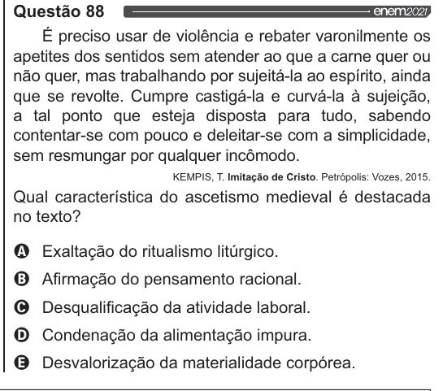

Texto extraído (pode conter ruído)

Questão 88  
É preciso usar de violência e rebater varonilmente os  
apetites dos sentidos sem atender ao que a carne quer ou  
não quer, mas trabalhando por sujeitá-la ao espírito, ainda  
que se revolte. Cumpre castigá-la e curvá-la à sujeição,  
a tal ponto que esteja disposta para tudo, sabendo  
contentar-se com pouco e deleitar-se com a simplicidade,  
sem resmungar por qualquer incômodo.  
KEMPIS, T. Imitação de Cristo. Petrópolis: Vozes, 2015.  
Qual característica do ascetismo medieval é destacada  
no texto?  
VOO  
Exaltação do ritualismo litúrgico.  
Afirmação do pensamento racional.  
Desqualificação da atividade laboral.  
Condenação da alimentação impura.  
Desvalorização da materialidade corpórea.

