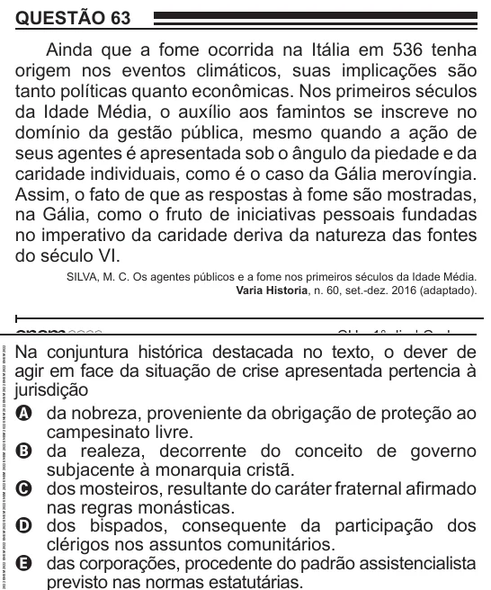

Texto extraído (pode conter ruído)

QUESTÃO 63  
Ainda que a fome ocorrida na Itália em 536 tenha  
origem nos eventos climáticos, suas implicações são  
tanto políticas quanto econômicas. Nos primeiros séculos  
da Idade Média, o auxílio aos famintos se inscreve no  
domínio da gestão pública, mesmo quando a ação de  
seus agentes é apresentada sob o ângulo da piedade e da  
caridade individuais, como é o caso da Gália merovíngia.  
Assim, o fato de que as respostas à fome são mostradas,  
na Gália, como o fruto de iniciativas pessoais fundadas  
no imperativo da caridade deriva da natureza das fontes  
do século VI.  
SILVA, M. C. Os agentes públicos e a fome nos primeiros séculos da Idade Média.  
Varia Historia, n. 60, set.-dez. 2016 (adaptado).  
Na conjuntura histórica destacada no texto, o dever de  
agir em face da situação de crise apresentada pertencia à  
jurisdição  
A da nobreza, proveniente da obrigação de proteção ao  
campesinato livre.  
B da realeza, decorrente do conceito de governo  
subjacente à monarquia cristã.  
C dos mosteiros, resultante do caráter fraternal afirmado  
nas regras monásticas.  
D dos bispados, consequente da participação dos  
clérigos nos assuntos comunitários.  
E das corporações, procedente do padrão assistencialista

