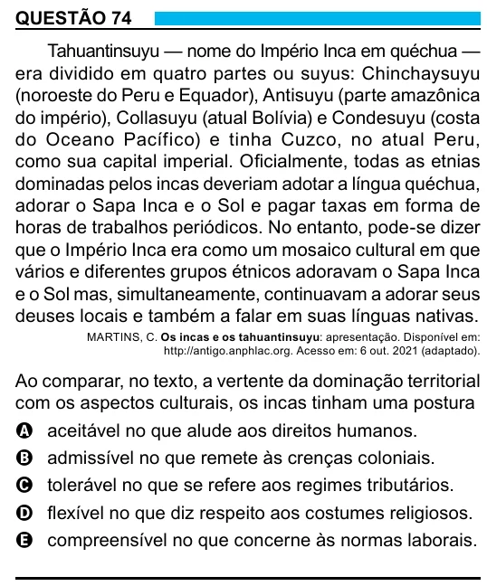

Texto extraído (pode conter ruído)

QUESTÃO 74  
Tahuantinsuyu — nome do Império Inca em quéchua —  
era dividido em quatro partes ou suyus: Chinchaysuyu  
(noroeste do Peru e Equador), Antisuyu (parte amazônica  
do império), Collasuyu (atual Bolívia) e Condesuyu (costa  
do Oceano Pacífico) e tinha Cuzco, no atual Peru,  
como sua capital imperial. Oficialmente, todas as etnias  
dominadas pelos incas deveriam adotar a língua quéchua,  
adorar o Sapa Inca e o Sol e pagar taxas em forma de  
horas de trabalhos periódicos. No entanto, pode-se dizer  
que o Império Inca era como um mosaico cultural em que  
vários e diferentes grupos étnicos adoravam o Sapa Inca  
e o Sol mas, simultaneamente, continuavam a adorar seus  
deuses locais e também a falar em suas línguas nativas.  
MARTINS, C. Os incas e os tahuantinsuyu: apresentação. Disponível em:  
http://antigo.anphlac.org. Acesso em: 6 out. 2021 (adaptado).  
Ao comparar, no texto, a vertente da dominação territorial  
com os aspectos culturais, os incas tinham uma postura  
A aceitável no que alude aos direitos humanos.  
B admissível no que remete às crenças coloniais.  
C tolerável no que se refere aos regimes tributários.  
D flexível no que diz respeito aos costumes religiosos.  
E compreensível no que concerne às normas laborais.

