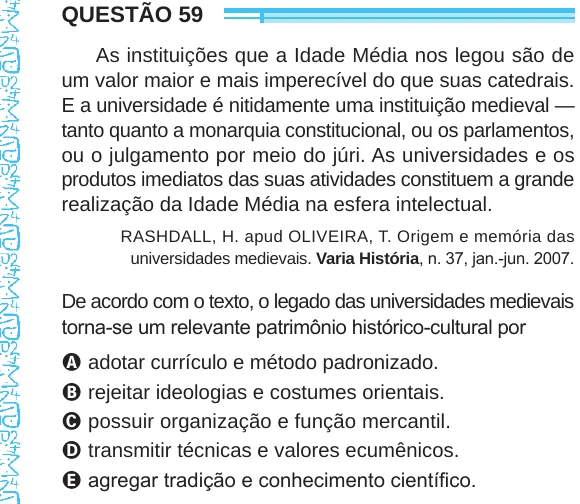

Texto extraído (pode conter ruído)

QUESTÃO 59  
As instituições que a Idade Média nos legou são de  
um valor maior e mais imperecível do que suas catedrais.  
E a universidade é nitidamente uma instituição medieval —  
tanto quanto a monarquia constitucional, ou os parlamentos,  
ou o julgamento por meio do júri. As universidades e os  
produtos imediatos das suas atividades constituem a grande  
realização da Idade Média na esfera intelectual.  
RASHDALL, H. apud OLIVEIRA, T. Origem e memória das  
universidades medievais. Varia História, n. 37, jan.-jun. 2007.  
De acordo com o texto, o legado das universidades medievais  
torna-se um relevante patrimônio histórico-cultural por  
A adotar currículo e método padronizado.  
B rejeitar ideologias e costumes orientais.  
C possuir organização e função mercantil.  
D transmitir técnicas e valores ecumênicos.  
E agregar tradição e conhecimento científico.

