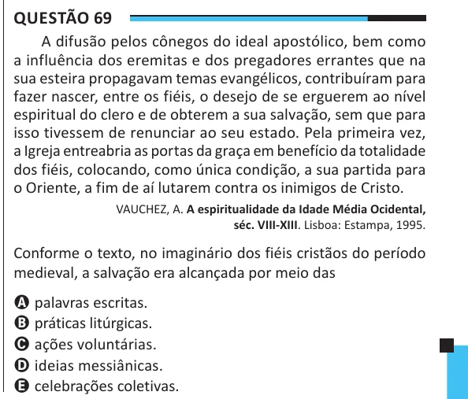

Texto extraído (pode conter ruído)

Questão 69  
A difusão pelos cônegos do ideal apostólico, bem como  
a influência dos eremitas e dos pregadores errantes que na  
sua esteira propagavam temas evangélicos, contribuíram para  
fazer nascer, entre os fiéis, o desejo de se erguerem ao nível  
espiritual do clero e de obterem a sua salvação, sem que para  
isso tivessem de renunciar ao seu estado. Pela primeira vez,  
a Igreja entreabria as portas da graça em benefício da totalidade  
dos fiéis, colocando, como única condição, a sua partida para  
o Oriente, a fim de aí lutarem contra os inimigos de Cristo.  
VAUCHEZ, A. A espiritualidade da Idade Média Ocidental,  
séc. VIII-XIII. Lisboa: Estampa, 1995.  
Conforme o texto, no imaginário dos fiéis cristãos do período  
medieval, a salvação era alcançada por meio das  
A palavras escritas.  
B práticas litúrgicas.  
C ações voluntárias.  
D ideias messiânicas.  
E celebrações coletivas.

