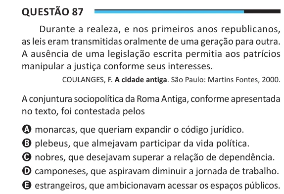

Texto extraído (pode conter ruído)

Questão 87  
Durante a realeza, e nos primeiros anos republicanos,  
as leis eram transmitidas oralmente de uma geração para outra.  
A ausência de uma legislação escrita permitia aos patrícios  
manipular a justiça conforme seus interesses.  
COULANGES, F. A cidade antiga. São Paulo: Martins Fontes, 2000.  
A conjuntura sociopolítica da Roma Antiga, conforme apresentada  
no texto, foi contestada pelos  
A monarcas, que queriam expandir o código jurídico.  
B plebeus, que almejavam participar da vida política.  
C nobres, que desejavam superar a relação de dependência.  
D camponeses, que aspiravam diminuir a jornada de trabalho.  
E estrangeiros, que ambicionavam acessar os espaços públicos.

