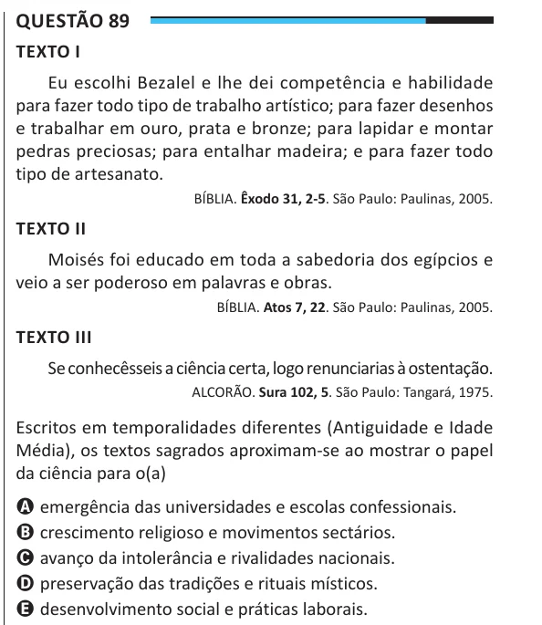

Texto extraído (pode conter ruído)

Questão 89  
TEXTO I  
Eu escolhi Bezalel e lhe dei competência e habilidade  
para fazer todo tipo de trabalho artístico; para fazer desenhos  
e trabalhar em ouro, prata e bronze; para lapidar e montar  
pedras preciosas; para entalhar madeira; e para fazer todo  
tipo de artesanato.  
BÍBLIA. Êxodo 31, 2-5. São Paulo: Paulinas, 2005.  
TEXTO II  
Moisés foi educado em toda a sabedoria dos egípcios e  
veio a ser poderoso em palavras e obras.  
BÍBLIA. Atos 7, 22. São Paulo: Paulinas, 2005.  
TEXTO III  
Se conhecêsseis a ciência certa, logo renunciarias à ostentação.  
ALCORÃO. Sura 102, 5. São Paulo: Tangará, 1975.  
Escritos em temporalidades diferentes (Antiguidade e Idade  
Média), os textos sagrados aproximam-se ao mostrar o papel  
da ciência para o(a)  
A emergência das universidades e escolas confessionais.  
B crescimento religioso e movimentos sectários.  
C avanço da intolerância e rivalidades nacionais.  
D preservação das tradições e rituais místicos.  
E desenvolvimento social e práticas laborais.

