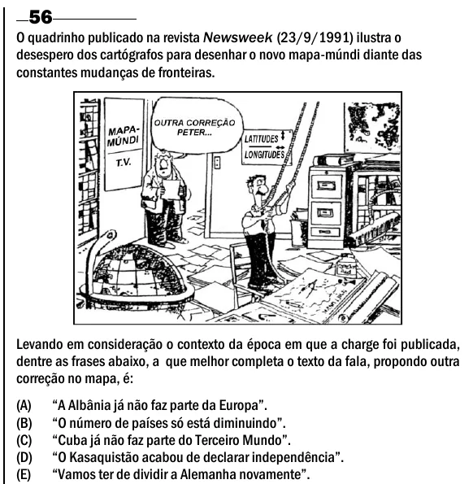

Texto extraído (pode conter ruído)

56  
O quadrinho publicado na revista Newsweek (23/9/1991) ilustra o  
desespero dos cartógrafos para desenhar o novo mapa-múndi diante das  
constantes mudanças de fronteiras.  
Levando em consideração o contexto da época em que a charge foi publicada,  
dentre as frases abaixo, a que melhor completa o texto da fala, propondo outra  
correção no mapa, é:  
(A)  
“A Albânia já não faz parte da Europa”.  
(B)  
“O número de países só está diminuindo”.  
(C)  
“Cuba já não faz parte do Terceiro Mundo”.  
(D)  
“O Kasaquistão acabou de declarar independência”.  
(E)  
“Vamos ter de dividir a Alemanha novamente”.

