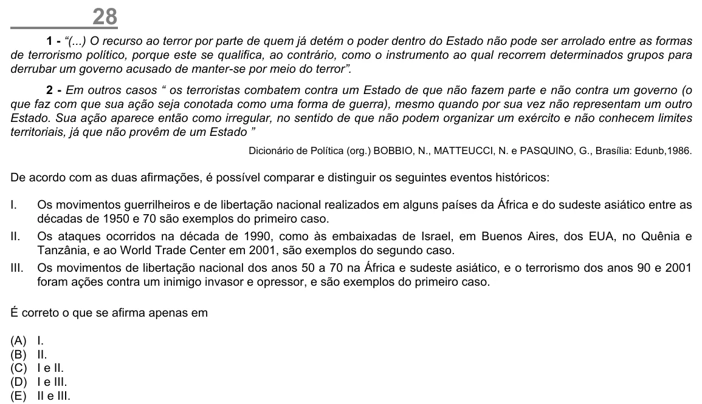

Texto extraído (pode conter ruído)

28  
1 - “(...) O recurso ao terror por parte de quem já detém o poder dentro do Estado não pode ser arrolado entre as formas  
de terrorismo político, porque este se qualifica, ao contrário, como o instrumento ao qual recorrem determinados grupos para  
derrubar um governo acusado de manter-se por meio do terror”.  
2 - Em outros casos “ os terroristas combatem contra um Estado de que não fazem parte e não contra um governo (o  
que faz com que sua ação seja conotada como uma forma de guerra), mesmo quando por sua vez não representam um outro  
Estado. Sua ação aparece então como irregular, no sentido de que não podem organizar um exército e não conhecem limites  
territoriais, já que não provêm de um Estado ”  
Dicionário de Política (org.) BOBBIO, N., MATTEUCCI, N. e PASQUINO, G., Brasília: Edunb,1986.  
De acordo com as duas afirmações, é possível comparar e distinguir os seguintes eventos históricos:  
I.  
Os movimentos guerrilheiros e de libertação nacional realizados em alguns países da África e do sudeste asiático entre as  
décadas de 1950 e 70 são exemplos do primeiro caso.  
II.  
Os ataques ocorridos na década de 1990, como às embaixadas de Israel, em Buenos Aires, dos EUA, no Quênia e  
Tanzânia, e ao World Trade Center em 2001, são exemplos do segundo caso.  
III.  
Os movimentos de libertação nacional dos anos 50 a 70 na África e sudeste asiático, e o terrorismo dos anos 90 e 2001  
foram ações contra um inimigo invasor e opressor, e são exemplos do primeiro caso.  
É correto o que se afirma apenas em  
(A)  
I.  
(B)  
II.  
(C)  
I e II.  
(D)  
I e III.  
(E)  
II e III.

