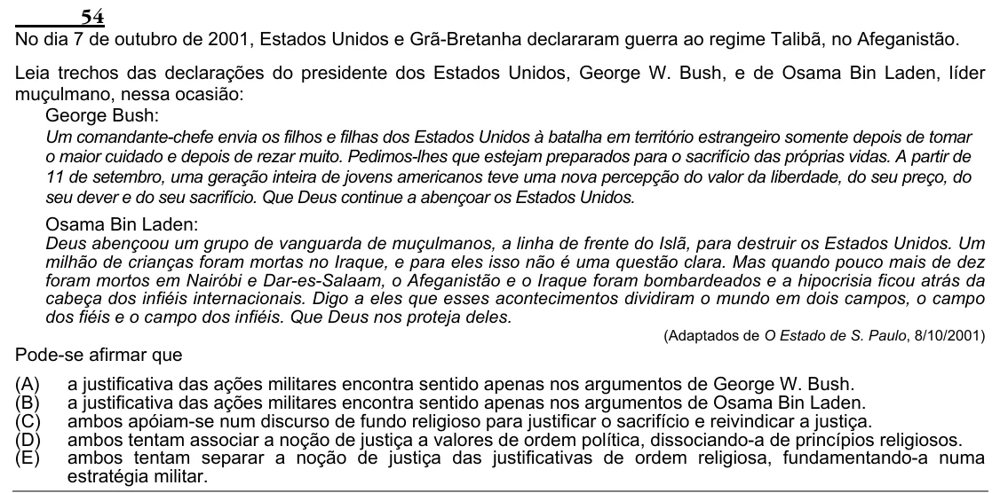

Texto extraído (pode conter ruído)

54  
No dia 7 de outubro de 2001, Estados Unidos e Grã-Bretanha declararam guerra ao regime Talibã, no Afeganistão.  
Leia trechos das declarações do presidente dos Estados Unidos, George W. Bush, e de Osama Bin Laden, líder  
muçulmano, nessa ocasião:  
George Bush:  
Um comandante-chefe envia os filhos e filhas dos Estados Unidos à batalha em território estrangeiro somente depois de tomar  
o maior cuidado e depois de rezar muito. Pedimos-lhes que estejam preparados para o sacrifício das próprias vidas. A partir de  
11 de setembro, uma geração inteira de jovens americanos teve uma nova percepção do valor da liberdade, do seu preço, do  
seu dever e do seu sacrifício. Que Deus continue a abençoar os Estados Unidos.  
Osama Bin Laden:  
Deus abençoou um grupo de vanguarda de muçulmanos, a linha de frente do Islã, para destruir os Estados Unidos. Um  
milhão de crianças foram mortas no Iraque, e para eles isso não é uma questão clara. Mas quando pouco mais de dez  
foram mortos em Nairóbi e Dar-es-Salaam, o Afeganistão e o Iraque foram bombardeados e a hipocrisia ficou atrás da  
cabeça dos infiéis internacionais. Digo a eles que esses acontecimentos dividiram o mundo em dois campos, o campo  
dos fiéis e o campo dos infiéis. Que Deus nos proteja deles.  
(Adaptados de O Estado de S. Paulo, 8/10/2001)  
Pode-se afirmar que  
(A)  
a justificativa das ações militares encontra sentido apenas nos argumentos de George W. Bush.  
(B)  
a justificativa das ações militares encontra sentido apenas nos argumentos de Osama Bin Laden.  
(C)  
ambos apóiam-se num discurso de fundo religioso para justificar o sacrifício e reivindicar a justiça.  
(D)  
ambos tentam associar a noção de justiça a valores de ordem política, dissociando-a de princípios religiosos.  
(E)  
ambos tentam separar a noção de justiça das justificativas de ordem religiosa, fundamentando-a numa  
estratégia militar.

