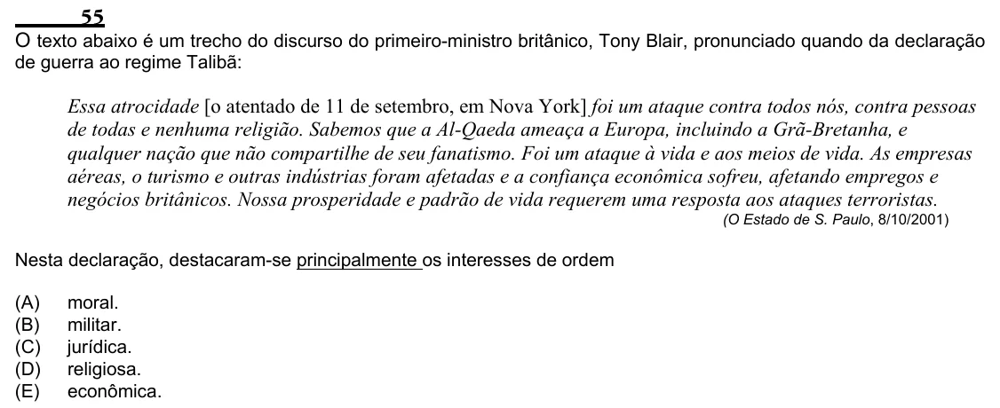

Texto extraído (pode conter ruído)

55  
O texto abaixo é um trecho do discurso do primeiro-ministro britânico, Tony Blair, pronunciado quando da declaração  
de guerra ao regime Talibã:  
Essa atrocidade [o atentado de 11 de setembro, em Nova York] foi um ataque contra todos nós, contra pessoas  
de todas e nenhuma religião. Sabemos que a Al-Qaeda ameaça a Europa, incluindo a Grã-Bretanha, e  
qualquer nação que não compartilhe de seu fanatismo. Foi um ataque à vida e aos meios de vida. As empresas  
aéreas, o turismo e outras indústrias foram afetadas e a confiança econômica sofreu, afetando empregos e  
negócios britânicos. Nossa prosperidade e padrão de vida requerem uma resposta aos ataques terroristas.  
(O Estado de S. Paulo, 8/10/2001)  
Nesta declaração, destacaram-se principalmente os interesses de ordem  
(A)  
moral.  
(B)  
militar.  
(C)  
jurídica.  
(D)  
religiosa.  
(E)  
econômica.

