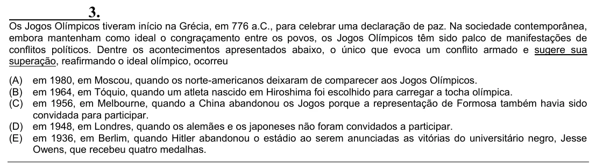

Texto extraído (pode conter ruído)

3.  
Os Jogos Olímpicos tiveram início na Grécia, em 776 a.C., para celebrar uma declaração de paz. Na sociedade contemporânea,  
embora mantenham como ideal o congraçamento entre os povos, os Jogos Olímpicos têm sido palco de manifestações de  
conflitos políticos. Dentre os acontecimentos apresentados abaixo, o único que evoca um conflito armado e sugere sua  
superação, reafirmando o ideal olímpico, ocorreu  
(A) em 1980, em Moscou, quando os norte-americanos deixaram de comparecer aos Jogos Olímpicos.  
(B) em 1964, em Tóquio, quando um atleta nascido em Hiroshima foi escolhido para carregar a tocha olímpica.  
(C) em 1956, em Melbourne, quando a China abandonou os Jogos porque a representação de Formosa também havia sido  
convidada para participar.  
(D) em 1948, em Londres, quando os alemães e os japoneses não foram convidados a participar.  
(E) em 1936, em Berlim, quando Hitler abandonou o estádio ao serem anunciadas as vitórias do universitário negro, Jesse  
Owens, que recebeu quatro medalhas.

