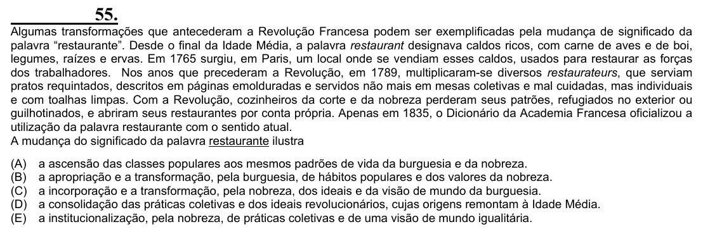

Texto extraído (pode conter ruído)

55.  
Algumas transformações que antecederam a Revolução Francesa podem ser exemplificadas pela mudança de significado da  
palavra “restaurante”. Desde o final da Idade Média, a palavra restaurant designava caldos ricos, com carne de aves e de boi,  
legumes, raízes e ervas. Em 1765 surgiu, em Paris, um local onde se vendiam esses caldos, usados para restaurar as forças  
dos trabalhadores. Nos anos que precederam a Revolução, em 1789, multiplicaram-se diversos restaurateurs, que serviam  
pratos requintados, descritos em páginas emolduradas e servidos não mais em mesas coletivas e mal cuidadas, mas individuais  
e com toalhas limpas. Com a Revolução, cozinheiros da corte e da nobreza perderam seus patrões, refugiados no exterior ou  
guilhotinados, e abriram seus restaurantes por conta própria. Apenas em 1835, o Dicionário da Academia Francesa oficializou a  
utilização da palavra restaurante com o sentido atual.  
A mudança do significado da palavra restaurante ilustra  
(A)  
a ascensão das classes populares aos mesmos padrões de vida da burguesia e da nobreza.  
(B)  
a apropriação e a transformação, pela burguesia, de hábitos populares e dos valores da nobreza.  
(C)  
a incorporação e a transformação, pela nobreza, dos ideais e da visão de mundo da burguesia.  
(D)  
a consolidação das práticas coletivas e dos ideais revolucionários, cujas origens remontam à Idade Média.  
(E)  
a institucionalização, pela nobreza, de práticas coletivas e de uma visão de mundo igualitária.

