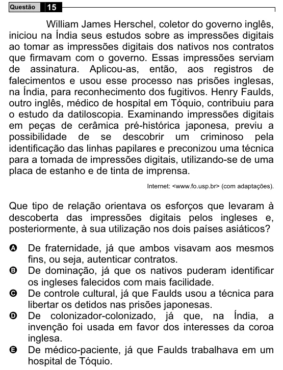

Texto extraído (pode conter ruído)

15  
Questão  
William James Herschel, coletor do governo inglês,  
iniciou na Índia seus estudos sobre as impressões digitais  
ao tomar as impressões digitais dos nativos nos contratos  
que firmavam com o governo. Essas impressões serviam  
de assinatura. Aplicou-as, então, aos registros de  
falecimentos e usou esse processo nas prisões inglesas,  
na Índia, para reconhecimento dos fugitivos. Henry Faulds,  
outro inglês, médico de hospital em Tóquio, contribuiu para  
o estudo da datiloscopia. Examinando impressões digitais  
em peças de cerâmica pré-histórica japonesa, previu a  
possibilidade de se descobrir um criminoso pela  
identificação das linhas papilares e preconizou uma técnica  
para a tomada de impressões digitais, utilizando-se de uma  
placa de estanho e de tinta de imprensa.  
Internet: <www.fo.usp.br> (com adaptações).  
Que tipo de relação orientava os esforços que levaram à  
descoberta das impressões digitais pelos ingleses e,  
posteriormente, à sua utilização nos dois países asiáticos?  
A  
De fraternidade, já que ambos visavam aos mesmos  
fins, ou seja, autenticar contratos.  
B  
De dominação, já que os nativos puderam identificar  
os ingleses falecidos com mais facilidade.  
De controle cultural, já que Faulds usou a técnica para  
C  
libertar os detidos nas prisões japonesas.  
De colonizador-colonizado, já que, na Índia, a  
D  
invenção foi usada em favor dos interesses da coroa  
inglesa.  
E  
De médico-paciente, já que Faulds trabalhava em um  
hospital de Tóquio.

