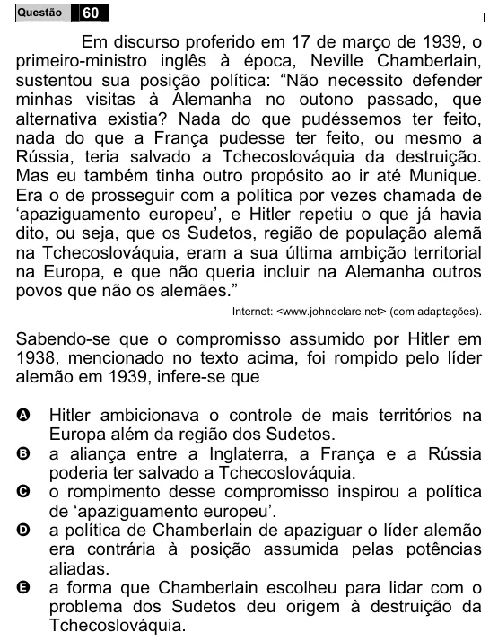

Texto extraído (pode conter ruído)

60  
Questão  
Em discurso proferido em 17 de março de 1939, o  
primeiro-ministro inglês à época, Neville Chamberlain,  
sustentou sua posição política: “Não necessito defender  
minhas visitas à Alemanha no outono passado, que  
alternativa existia? Nada do que pudéssemos ter feito,  
nada do que a França pudesse ter feito, ou mesmo a  
Rússia, teria salvado a Tchecoslováquia da destruição.  
Mas eu também tinha outro propósito ao ir até Munique.  
Era o de prosseguir com a política por vezes chamada de  
‘apaziguamento europeu’, e Hitler repetiu o que já havia  
dito, ou seja, que os Sudetos, região de população alemã  
na Tchecoslováquia, eram a sua última ambição territorial  
na Europa, e que não queria incluir na Alemanha outros  
povos que não os alemães.”  
Internet: <www.johndclare.net> (com adaptações).  
Sabendo-se que o compromisso assumido por Hitler em  
1938, mencionado no texto acima, foi rompido pelo líder  
alemão em 1939, infere-se que  
A  
Hitler ambicionava o controle de mais territórios na  
Europa além da região dos Sudetos.  
B  
a aliança entre a Inglaterra, a França e a Rússia  
poderia ter salvado a Tchecoslováquia.  
o rompimento desse compromisso inspirou a política  
C  
de ‘apaziguamento europeu’.  
a política de Chamberlain de apaziguar o líder alemão  
D  
era contrária à posição assumida pelas potências  
aliadas.  
a forma que Chamberlain escolheu para lidar com o  
E  
problema dos Sudetos deu origem à destruição da  
Tchecoslováquia.

