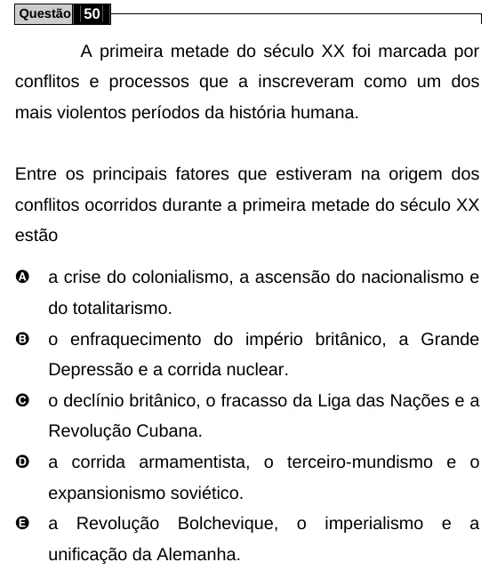

Texto extraído (pode conter ruído)

Questão 50  
A primeira metade do século XX foi marcada por  
conflitos e processos que a inscreveram como um dos  
mais violentos períodos da história humana.  
Entre os principais fatores que estiveram na origem dos  
conflitos ocorridos durante a primeira metade do século XX  
estão  
A  
a crise do colonialismo, a ascensão do nacionalismo e  
do totalitarismo.  
B  
o enfraquecimento do império britânico, a Grande  
Depressão e a corrida nuclear.  
C  
o declínio britânico, o fracasso da Liga das Nações e a  
Revolução Cubana.  
D  
a corrida armamentista, o terceiro-mundismo e o  
expansionismo soviético.  
E  
a  
Revolução  
Bolchevique,  
o  
imperialismo  
e  
a  
unificação da Alemanha.

