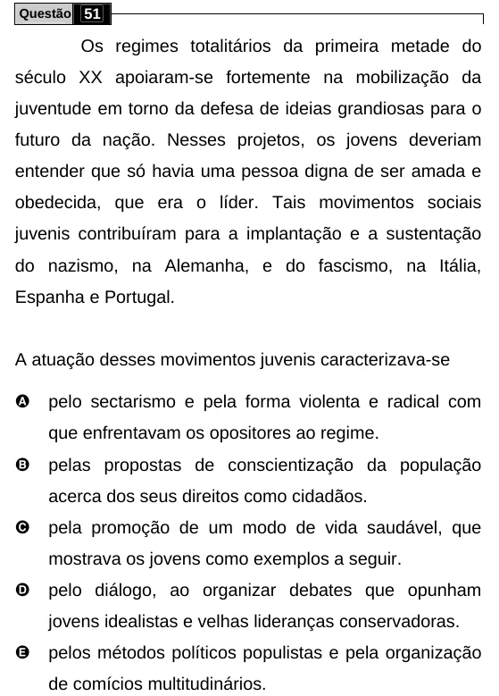

Texto extraído (pode conter ruído)

Questão 51  
Os regimes totalitários da primeira metade do  
século XX apoiaram-se fortemente na mobilização da  
juventude em torno da defesa de ideias grandiosas para o  
futuro da nação. Nesses projetos, os jovens deveriam  
entender que só havia uma pessoa digna de ser amada e  
obedecida, que era o líder. Tais movimentos sociais  
juvenis contribuíram para a implantação e a sustentação  
do nazismo, na Alemanha, e do fascismo, na Itália,  
Espanha e Portugal.  
A atuação desses movimentos juvenis caracterizava-se  
A  
pelo sectarismo e pela forma violenta e radical com  
que enfrentavam os opositores ao regime.  
B  
pelas propostas de conscientização da população  
acerca dos seus direitos como cidadãos.  
C  
pela promoção de um modo de vida saudável, que  
mostrava os jovens como exemplos a seguir.  
D  
pelo diálogo, ao organizar debates que opunham  
jovens idealistas e velhas lideranças conservadoras.  
E  
pelos métodos políticos populistas e pela organização  
de comícios multitudinários.

