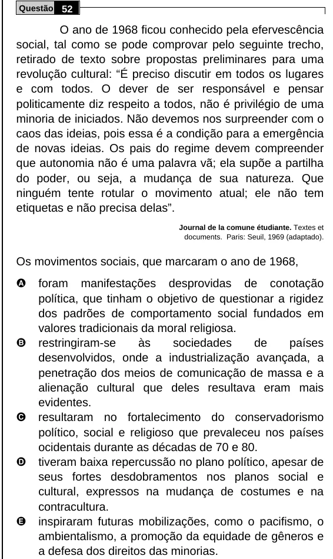

Texto extraído (pode conter ruído)

Questão 52  
O ano de 1968 ficou conhecido pela efervescência  
social, tal como se pode comprovar pelo seguinte trecho,  
retirado de texto sobre propostas preliminares para uma  
revolução cultural: “É preciso discutir em todos os lugares  
e com todos. O dever de ser responsável e pensar  
politicamente diz respeito a todos, não é privilégio de uma  
minoria de iniciados. Não devemos nos surpreender com o  
caos das ideias, pois essa é a condição para a emergência  
de novas ideias. Os pais do regime devem compreender  
que autonomia não é uma palavra vã; ela supõe a partilha  
do poder, ou seja, a mudança de sua natureza. Que  
ninguém tente rotular o movimento atual; ele não tem  
etiquetas e não precisa delas”.  
Journal de la comune étudiante. Textes et  
documents. Paris: Seuil, 1969 (adaptado).  
Os movimentos sociais, que marcaram o ano de 1968,  
A  
foram manifestações desprovidas de conotação  
política, que tinham o objetivo de questionar a rigidez  
dos padrões de comportamento social fundados em  
valores tradicionais da moral religiosa.  
B  
restringiram-se  
às  
sociedades  
de  
países  
desenvolvidos, onde a industrialização avançada, a  
penetração dos meios de comunicação de massa e a  
alienação cultural que deles resultava eram mais  
evidentes.  
C  
resultaram no fortalecimento do conservadorismo  
político, social e religioso que prevaleceu nos países  
ocidentais durante as décadas de 70 e 80.  
D  
tiveram baixa repercussão no plano político, apesar de  
seus fortes desdobramentos nos planos social e  
cultural, expressos na mudança de costumes e na  
contracultura.  
E  
inspiraram futuras mobilizações, como o pacifismo, o  
ambientalismo, a promoção da equidade de gêneros e  
a defesa dos direitos das minorias.

