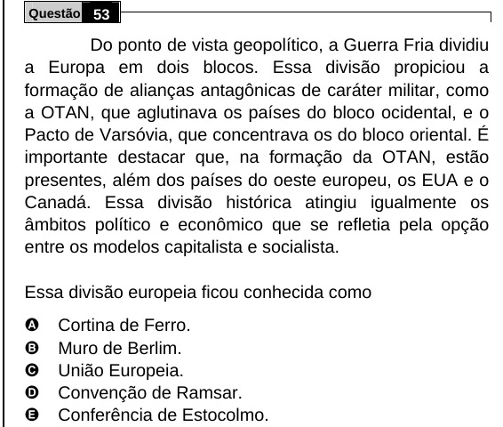

Texto extraído (pode conter ruído)

Questão 53  
Do ponto de vista geopolítico, a Guerra Fria dividiu  
a Europa em dois blocos. Essa divisão propiciou a  
formação de alianças antagônicas de caráter militar, como  
a OTAN, que aglutinava os países do bloco ocidental, e o  
Pacto de Varsóvia, que concentrava os do bloco oriental. É  
importante destacar que, na formação da OTAN, estão  
presentes, além dos países do oeste europeu, os EUA e o  
Canadá. Essa divisão histórica atingiu igualmente os  
âmbitos político e econômico que se refletia pela opção  
entre os modelos capitalista e socialista.  
Essa divisão europeia ficou conhecida como  
A  
Cortina de Ferro.  
B  
Muro de Berlim.  
C  
União Europeia.  
D  
Convenção de Ramsar.  
E  
Conferência de Estocolmo.

