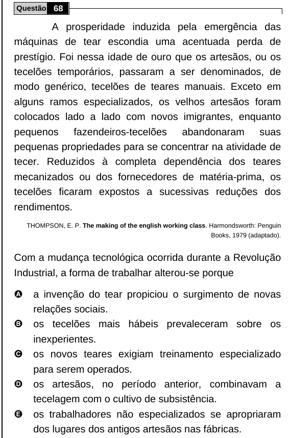

Texto extraído (pode conter ruído)

Questão 68  
A prosperidade induzida pela emergência das  
máquinas de tear escondia uma acentuada perda de  
prestígio. Foi nessa idade de ouro que os artesãos, ou os  
tecelões temporários, passaram a ser denominados, de  
modo genérico, tecelões de teares manuais. Exceto em  
alguns ramos especializados, os velhos artesãos foram  
colocados lado a lado com novos imigrantes, enquanto  
pequenos fazendeiros-tecelões abandonaram suas  
pequenas propriedades para se concentrar na atividade de  
tecer. Reduzidos à completa dependência dos teares  
mecanizados ou dos fornecedores de matéria-prima, os  
tecelões ficaram expostos a sucessivas reduções dos  
rendimentos.  
THOMPSON, E. P. The making of the english working class. Harmondsworth: Penguin  
Books, 1979 (adaptado).  
Com a mudança tecnológica ocorrida durante a Revolução  
Industrial, a forma de trabalhar alterou-se porque  
A  
a invenção do tear propiciou o surgimento de novas  
relações sociais.  
B  
os tecelões mais hábeis prevaleceram sobre os  
inexperientes.  
C  
os novos teares exigiam treinamento especializado  
para serem operados.  
D  
os artesãos, no período anterior, combinavam a  
tecelagem com o cultivo de subsistência.  
E  
os trabalhadores não especializados se apropriaram  
dos lugares dos antigos artesãos nas fábricas.

