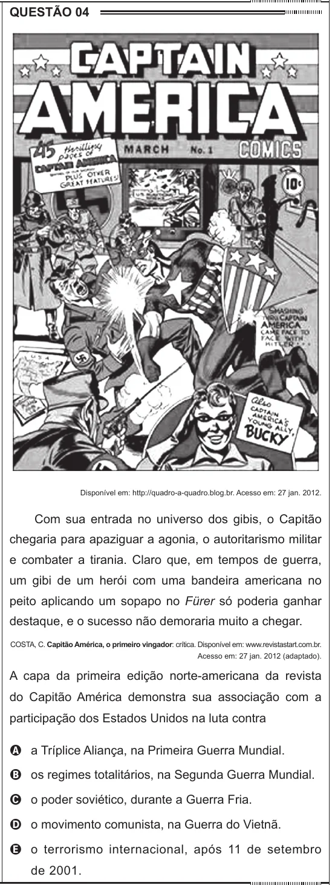

Texto extraído (pode conter ruído)

QUESTÃO 04  
Disponível em: http://quadro-a-quadro.blog.br. Acesso em: 27 jan. 2012.  
Com sua entrada no universo dos gibis, o Capitão  
chegaria para apaziguar a agonia, o autoritarismo militar  
e combater a tirania. Claro que, em tempos de guerra,  
um gibi de um herói com uma bandeira americana no  
peito aplicando um sopapo no Fürer só poderia ganhar  
destaque, e o sucesso não demoraria muito a chegar.  
COSTA, C. Capitão América, o primeiro vingador: crítica. Disponível em: www.revistastart.com.br.  
Acesso em: 27 jan. 2012 (adaptado).  
A capa da primeira edição norte-americana da revista  
do Capitão América demonstra sua associação com a  
participação dos Estados Unidos na luta contra  
A a Tríplice Aliança, na Primeira Guerra Mundial.  
B os regimes totalitários, na Segunda Guerra Mundial.  
C o poder soviético, durante a Guerra Fria.  
D o movimento comunista, na Guerra do Vietnã.  
E o terrorismo internacional, após 11 de setembro  
de 2001.

