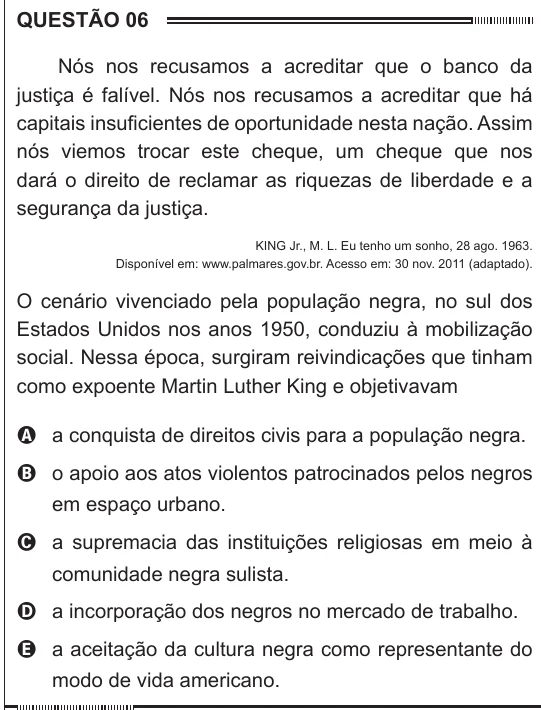

Texto extraído (pode conter ruído)

QUESTÃO 06  
Nós nos recusamos a acreditar que o banco da  
justiça é falível. Nós nos recusamos a acreditar que há  
capitais insuficientes de oportunidade nesta nação. Assim  
nós viemos trocar este cheque, um cheque que nos  
dará o direito de reclamar as riquezas de liberdade e a  
segurança da justiça.  
KING Jr., M. L. Eu tenho um sonho, 28 ago. 1963.  
Disponível em: www.palmares.gov.br. Acesso em: 30 nov. 2011 (adaptado).  
O cenário vivenciado pela população negra, no sul dos  
Estados Unidos nos anos 1950, conduziu à mobilização  
social. Nessa época, surgiram reivindicações que tinham  
como expoente Martin Luther King e objetivavam  
A a conquista de direitos civis para a população negra.  
B o apoio aos atos violentos patrocinados pelos negros  
em espaço urbano.  
C a supremacia das instituições religiosas em meio à  
comunidade negra sulista.  
D a incorporação dos negros no mercado de trabalho.  
E a aceitação da cultura negra como representante do  
modo de vida americano.

