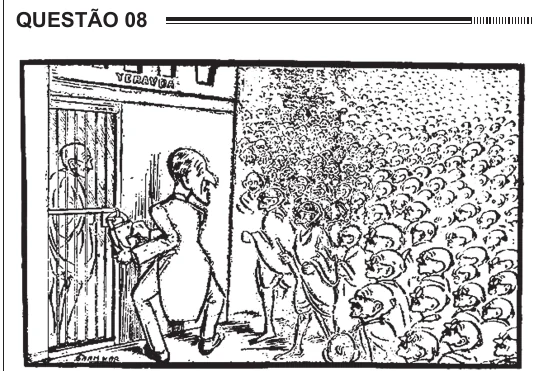

Texto extraído (pode conter ruído)

QUESTÃO 08  
Disponível em: www.gandhiserve.org. Acesso em: 21 nov. 2011.  
O cartum, publicado em 1932, ironiza as consequências  
sociais das constantes prisões de Mahatma Gandhi pelas  
autoridades britânicas, na Índia, demonstrando  
A a ineficiência do sistema judiciário inglês no  
território indiano.  
B o apoio da população hindu à prisão de Gandhi.  
C o caráter violento das manifestações hindus frente à  
ação inglesa.  
D a impossibilidade de deter o movimento liderado  
por Gandhi.  
E a indiferença das autoridades britânicas frente ao  
apelo popular hindu.

