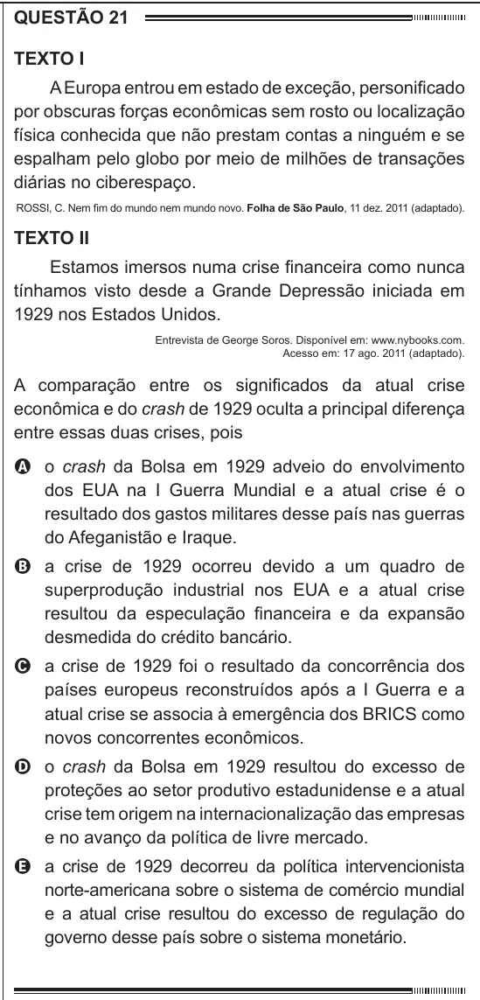

Texto extraído (pode conter ruído)

QUESTÃO 21  
Texto I  
A Europa entrou em estado de exceção, personificado  
por obscuras forças econômicas sem rosto ou localização  
física conhecida que não prestam contas a ninguém e se  
espalham pelo globo por meio de milhões de transações  
diárias no ciberespaço.  
ROSSI, C. Nem fim do mundo nem mundo novo. Folha de São Paulo, 11 dez. 2011 (adaptado).  
Texto II  
Estamos imersos numa crise financeira como nunca  
tínhamos visto desde a Grande Depressão iniciada em  
1929 nos Estados Unidos.  
Entrevista de George Soros. Disponível em: www.nybooks.com.  
Acesso em: 17 ago. 2011 (adaptado).  
A comparação entre os significados da atual crise  
econômica e do crash de 1929 oculta a principal diferença  
entre essas duas crises, pois  
A o crash da Bolsa em 1929 adveio do envolvimento  
dos EUA na I Guerra Mundial e a atual crise é o  
resultado dos gastos militares desse país nas guerras  
do Afeganistão e Iraque.  
B a crise de 1929 ocorreu devido a um quadro de  
superprodução industrial nos EUA e a atual crise  
resultou da especulação financeira e da expansão  
desmedida do crédito bancário.  
C a crise de 1929 foi o resultado da concorrência dos  
países europeus reconstruídos após a I Guerra e a  
atual crise se associa à emergência dos BRICS como  
novos concorrentes econômicos.  
D o crash da Bolsa em 1929 resultou do excesso de  
proteções ao setor produtivo estadunidense e a atual  
crise tem origem na internacionalização das empresas  
e no avanço da política de livre mercado.  
E a crise de 1929 decorreu da política intervencionista  
norte-americana sobre o sistema de comércio mundial  
e a atual crise resultou do excesso de regulação do  
governo desse país sobre o sistema monetário.

