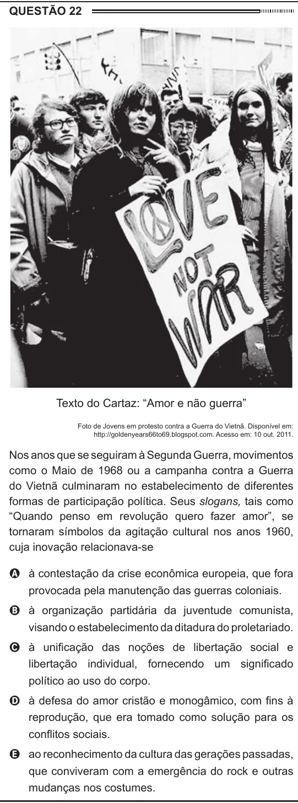

Texto extraído (pode conter ruído)

QUESTÃO 22  
Texto do Cartaz: “Amor e não guerra”  
Foto de Jovens em protesto contra a Guerra do Vietnã. Disponível em:  
http://goldenyears66to69.blogspot.com. Acesso em: 10 out. 2011.  
Nos anos que se seguiram à Segunda Guerra, movimentos  
como o Maio de 1968 ou a campanha contra a Guerra  
do Vietnã culminaram no estabelecimento de diferentes  
formas de participação política. Seus slogans, tais como  
“Quando penso em revolução quero fazer amor”, se  
tornaram símbolos da agitação cultural nos anos 1960,  
cuja inovação relacionava-se  
A à contestação da crise econômica europeia, que fora  
provocada pela manutenção das guerras coloniais.  
B à organização partidária da juventude comunista,  
visando o estabelecimento da ditadura do proletariado.  
C à unificação das noções de libertação social e  
libertação individual, fornecendo um significado  
político ao uso do corpo.  
D à defesa do amor cristão e monogâmico, com fins à  
reprodução, que era tomado como solução para os  
conflitos sociais.  
E ao reconhecimento da cultura das gerações passadas,  
que conviveram com a emergência do rock e outras  
mudanças nos costumes.

