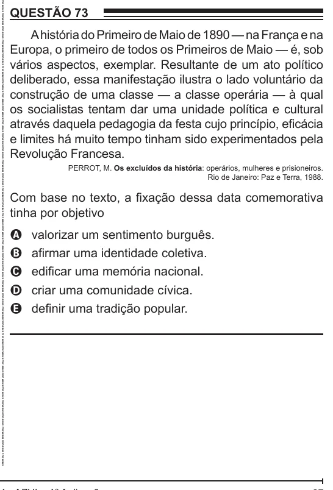

Texto extraído (pode conter ruído)

QUESTÃO 73  
A história do Primeiro de Maio de 1890 — na França e na  
Europa, o primeiro de todos os Primeiros de Maio — é, sob  
vários aspectos, exemplar. Resultante de um ato político  
deliberado, essa manifestação ilustra o lado voluntário da  
construção de uma classe — a classe operária — à qual  
os socialistas tentam dar uma unidade política e cultural  
através daquela pedagogia da festa cujo princípio, eficácia  
e limites há muito tempo tinham sido experimentados pela  
Revolução Francesa.  
PERROT, M. Os excluídos da história: operários, mulheres e prisioneiros.  
Rio de Janeiro: Paz e Terra, 1988.  
Com base no texto, a fixação dessa data comemorativa  
tinha por objetivo  
valorizar um sentimento burguês.  
A  
afirmar uma identidade coletiva.  
B  
edificar uma memória nacional.  
C  
criar uma comunidade cívica.  
D  
definir uma tradição popular.  
E

