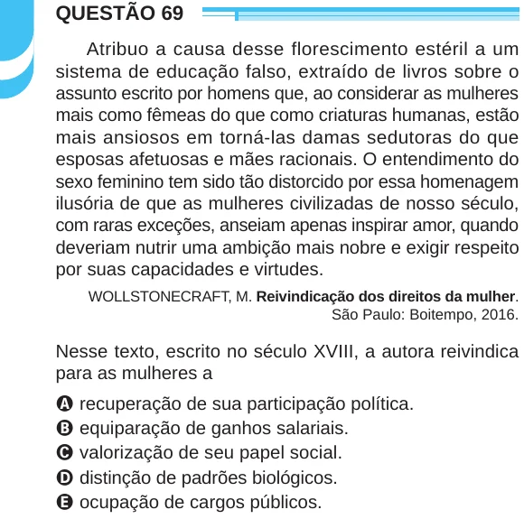

Texto extraído (pode conter ruído)

QUESTÃO 69  
Atribuo a causa desse florescimento estéril a um  
sistema de educação falso, extraído de livros sobre o  
assunto escrito por homens que, ao considerar as mulheres  
mais como fêmeas do que como criaturas humanas, estão  
mais ansiosos em torná-las damas sedutoras do que  
esposas afetuosas e mães racionais. O entendimento do  
sexo feminino tem sido tão distorcido por essa homenagem  
ilusória de que as mulheres civilizadas de nosso século,  
com raras exceções, anseiam apenas inspirar amor, quando  
deveriam nutrir uma ambição mais nobre e exigir respeito  
por suas capacidades e virtudes.  
WOLLSTONECRAFT, M. Reivindicação dos direitos da mulher.  
São Paulo: Boitempo, 2016.  
Nesse texto, escrito no século XVIII, a autora reivindica  
para as mulheres a  
A recuperação de sua participação política.  
B equiparação de ganhos salariais.  
C valorização de seu papel social.  
D distinção de padrões biológicos.  
E ocupação de cargos públicos.

