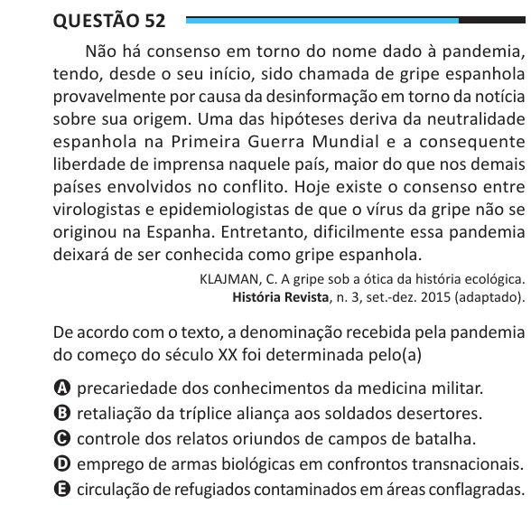

Texto extraído (pode conter ruído)

Questão 52  
Não há consenso em torno do nome dado à pandemia,  
tendo, desde o seu início, sido chamada de gripe espanhola  
provavelmente por causa da desinformação em torno da notícia  
sobre sua origem. Uma das hipóteses deriva da neutralidade  
espanhola na Primeira Guerra Mundial e a consequente  
liberdade de imprensa naquele país, maior do que nos demais  
países envolvidos no conflito. Hoje existe o consenso entre  
virologistas e epidemiologistas de que o vírus da gripe não se  
originou na Espanha. Entretanto, dificilmente essa pandemia  
deixará de ser conhecida como gripe espanhola.  
KLAJMAN, C. A gripe sob a ótica da história ecológica.  
História Revista, n. 3, set.-dez. 2015 (adaptado).  
De acordo com o texto, a denominação recebida pela pandemia  
do começo do século XX foi determinada pelo(a)  
A precariedade dos conhecimentos da medicina militar.  
B retaliação da tríplice aliança aos soldados desertores.  
C controle dos relatos oriundos de campos de batalha.  
D emprego de armas biológicas em confrontos transnacionais.  
E circulação de refugiados contaminados em áreas conflagradas.

