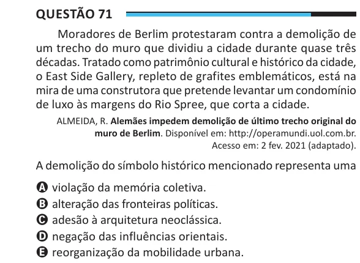

Texto extraído (pode conter ruído)

Questão 71  
Moradores de Berlim protestaram contra a demolição de  
um trecho do muro que dividiu a cidade durante quase três  
décadas. Tratado como patrimônio cultural e histórico da cidade,  
o East Side Gallery, repleto de grafites emblemáticos, está na  
mira de uma construtora que pretende levantar um condomínio  
de luxo às margens do Rio Spree, que corta a cidade.  
ALMEIDA, R. Alemães impedem demolição de último trecho original do  
muro de Berlim. Disponível em: http://operamundi.uol.com.br.  
Acesso em: 2 fev. 2021 (adaptado).  
A demolição do símbolo histórico mencionado representa uma  
A violação da memória coletiva.  
B alteração das fronteiras políticas.  
C adesão à arquitetura neoclássica.  
D negação das influências orientais.  
E reorganização da mobilidade urbana.

