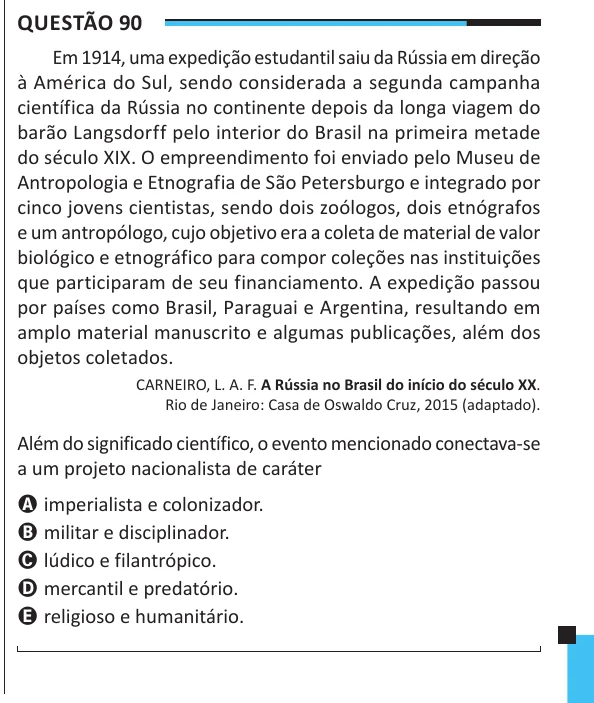

Texto extraído (pode conter ruído)

Questão 90  
Em 1914, uma expedição estudantil saiu da Rússia em direção  
à América do Sul, sendo considerada a segunda campanha  
científica da Rússia no continente depois da longa viagem do  
barão Langsdorff pelo interior do Brasil na primeira metade  
do século XIX. O empreendimento foi enviado pelo Museu de  
Antropologia e Etnografia de São Petersburgo e integrado por  
cinco jovens cientistas, sendo dois zoólogos, dois etnógrafos  
e um antropólogo, cujo objetivo era a coleta de material de valor  
biológico e etnográfico para compor coleções nas instituições  
que participaram de seu financiamento. A expedição passou  
por países como Brasil, Paraguai e Argentina, resultando em  
amplo material manuscrito e algumas publicações, além dos  
objetos coletados.  
CARNEIRO, L. A. F. A Rússia no Brasil do início do século XX.  
Rio de Janeiro: Casa de Oswaldo Cruz, 2015 (adaptado).  
Além do significado científico, o evento mencionado conectava-se  
a um projeto nacionalista de caráter  
A imperialista e colonizador.  
B militar e disciplinador.  
C lúdico e filantrópico.  
D mercantil e predatório.  
E religioso e humanitário.

