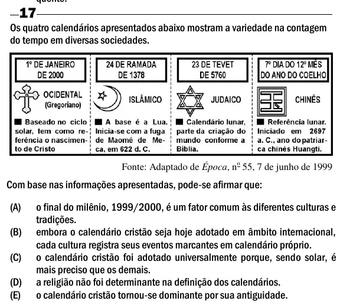

Texto extraído (pode conter ruído)

17  
Os quatro calendários apresentados abaixo mostram a variedade na contagem  
do tempo em diversas sociedades.  
Fonte: Adaptado de Época, n o 55, 7 de junho de 1999  
Com base nas informações apresentadas, pode-se afirmar que:  
(A)  
o final do milênio, 1999/2000, é um fator comum às diferentes culturas e  
tradições.  
(B)  
embora o calendário cristão seja hoje adotado em âmbito internacional,  
cada cultura registra seus eventos marcantes em calendário próprio.  
(C)  
o calendário cristão foi adotado universalmente porque, sendo solar, é  
mais preciso que os demais.  
(D)  
a religião não foi determinante na definição dos calendários.  
(E)  
o calendário cristão tornou-se dominante por sua antiguidade.

