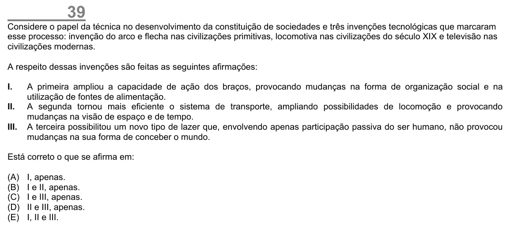

Texto extraído (pode conter ruído)

39  
Considere o papel da técnica no desenvolvimento da constituição de sociedades e três invenções tecnológicas que marcaram  
esse processo: invenção do arco e flecha nas civilizações primitivas, locomotiva nas civilizações do século XIX e televisão nas  
civilizações modernas.  
A respeito dessas invenções são feitas as seguintes afirmações:  
I.  
A primeira ampliou a capacidade de ação dos braços, provocando mudanças na forma de organização social e na  
utilização de fontes de alimentação.  
II.  
A segunda tornou mais eficiente o sistema de transporte, ampliando possibilidades de locomoção e provocando  
mudanças na visão de espaço e de tempo.  
III.  
A terceira possibilitou um novo tipo de lazer que, envolvendo apenas participação passiva do ser humano, não provocou  
mudanças na sua forma de conceber o mundo.  
Está correto o que se afirma em:  
(A)  
I, apenas.  
(B)  
I e II, apenas.  
(C)  
I e III, apenas.  
(D)  
II e III, apenas.  
(E)  
I, II e III.

