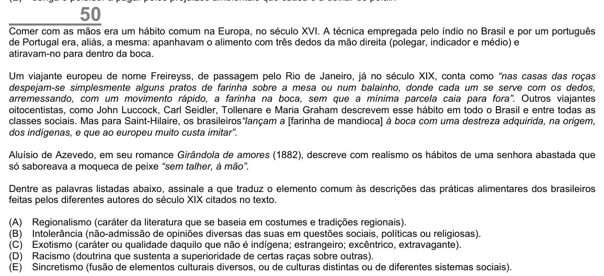

Texto extraído (pode conter ruído)

50  
Comer com as mãos era um hábito comum na Europa, no século XVI. A técnica empregada pelo índio no Brasil e por um português  
de Portugal era, aliás, a mesma: apanhavam o alimento com três dedos da mão direita (polegar, indicador e médio) e  
atiravam-no para dentro da boca.  
Um viajante europeu de nome Freireyss, de passagem pelo Rio de Janeiro, já no século XIX, conta como “nas casas das roças  
despejam-se simplesmente alguns pratos de farinha sobre a mesa ou num balainho, donde cada um se serve com os dedos,  
arremessando, com um movimento rápido, a farinha na boca, sem que a mínima parcela caia para fora”. Outros viajantes  
oitocentistas, como John Luccock, Carl Seidler, Tollenare e Maria Graham descrevem esse hábito em todo o Brasil e entre todas as  
classes sociais. Mas para Saint-Hilaire, os brasileiros“lançam a [farinha de mandioca] à boca com uma destreza adquirida, na origem,  
dos indígenas, e que ao europeu muito custa imitar”.  
Aluísio de Azevedo, em seu romance Girândola de amores (1882), descreve com realismo os hábitos de uma senhora abastada que  
só saboreava a moqueca de peixe “sem talher, à mão”.  
Dentre as palavras listadas abaixo, assinale a que traduz o elemento comum às descrições das práticas alimentares dos brasileiros  
feitas pelos diferentes autores do século XIX citados no texto.  
(A)  
Regionalismo (caráter da literatura que se baseia em costumes e tradições regionais).  
(B)  
Intolerância (não-admissão de opiniões diversas das suas em questões sociais, políticas ou religiosas).  
(C)  
Exotismo (caráter ou qualidade daquilo que não é indígena; estrangeiro; excêntrico, extravagante).  
(D)  
Racismo (doutrina que sustenta a superioridade de certas raças sobre outras).  
(E)  
Sincretismo (fusão de elementos culturais diversos, ou de culturas distintas ou de diferentes sistemas sociais).

