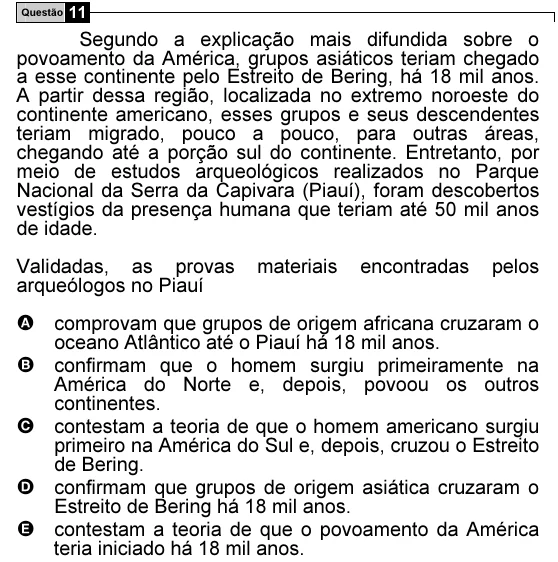

Texto extraído (pode conter ruído)

Questão 11  
Segundo a explicação mais difundida sobre o  
povoamento da América, grupos asiáticos teriam chegado  
a esse continente pelo Estreito de Bering, há 18 mil anos.  
A partir dessa região, localizada no extremo noroeste do  
continente americano, esses grupos e seus descendentes  
teriam migrado, pouco a pouco, para outras áreas,  
chegando até a porção sul do continente. Entretanto, por  
meio de estudos arqueológicos realizados no Parque  
Nacional da Serra da Capivara (Piauí), foram descobertos  
vestígios da presença humana que teriam até 50 mil anos  
de idade.  
Validadas, as provas  
materiais  
encontradas  
pelos  
arqueólogos no Piauí  
A comprovam que grupos de origem africana cruzaram o  
oceano Atlântico até o Piauí há 18 mil anos.  
B confirmam que o homem surgiu primeiramente na  
América do Norte e, depois, povoou os outros  
continentes.  
C contestam a teoria de que o homem americano surgiu  
primeiro na América do Sul e, depois, cruzou o Estreito  
de Bering.  
D confirmam que grupos de origem asiática cruzaram o  
Estreito de Bering há 18 mil anos.  
E contestam a teoria de que o povoamento da América  
teria iniciado há 18 mil anos.

