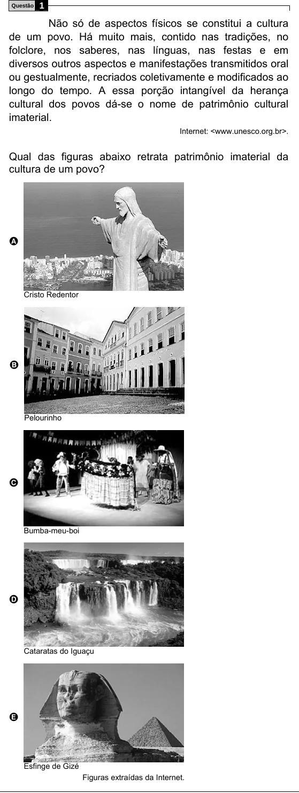

Texto extraído (pode conter ruído)

Questão  
1  
Não só de aspectos físicos se constitui a cultura  
de um povo. Há muito mais, contido nas tradições, no  
folclore, nos saberes, nas línguas, nas festas e em  
diversos outros aspectos e manifestações transmitidos oral  
ou gestualmente, recriados coletivamente e modificados ao  
longo do tempo. A essa porção intangível da herança  
cultural dos povos dá-se o nome de patrimônio cultural  
imaterial.  
Internet: <www.unesco.org.br>.  
Qual das figuras abaixo retrata patrimônio imaterial da  
cultura de um povo?  
A  
Cristo Redentor  
B  
Pelourinho  
C  
Bumba-meu-boi  
D  
Cataratas do Iguaçu  
E  
Esfinge de Gizé  
Figuras extraídas da Internet.

