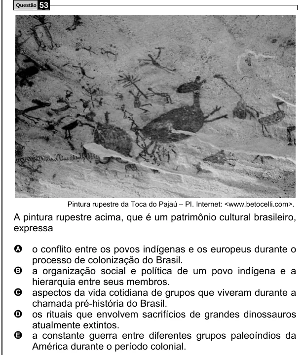

Texto extraído (pode conter ruído)

Questão  
53  
Pintura rupestre da Toca do Pajaú – PI. Internet: <www.betocelli.com>.  
A pintura rupestre acima, que é um patrimônio cultural brasileiro,  
expressa  
A o conflito entre os povos indígenas e os europeus durante o  
processo de colonização do Brasil.  
B a organização social e política de um povo indígena e a  
hierarquia entre seus membros.  
C aspectos da vida cotidiana de grupos que viveram durante a  
chamada pré-história do Brasil.  
D os rituais que envolvem sacrifícios de grandes dinossauros  
atualmente extintos.  
E a constante guerra entre diferentes grupos paleoíndios da  
América durante o período colonial.

