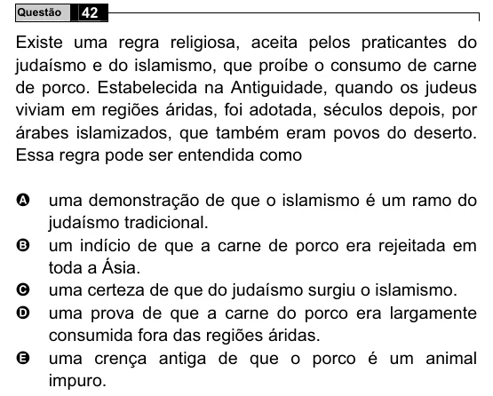

Texto extraído (pode conter ruído)

42  
Questão  
Existe uma regra religiosa, aceita pelos praticantes do  
judaísmo e do islamismo, que proíbe o consumo de carne  
de porco. Estabelecida na Antiguidade, quando os judeus  
viviam em regiões áridas, foi adotada, séculos depois, por  
árabes islamizados, que também eram povos do deserto.  
Essa regra pode ser entendida como  
A  
uma demonstração de que o islamismo é um ramo do  
judaísmo tradicional.  
B  
um indício de que a carne de porco era rejeitada em  
toda a Ásia.  
uma certeza de que do judaísmo surgiu o islamismo.  
C  
uma prova de que a carne do porco era largamente  
D  
consumida fora das regiões áridas.  
uma crença antiga de que o porco é um animal  
E  
impuro.

