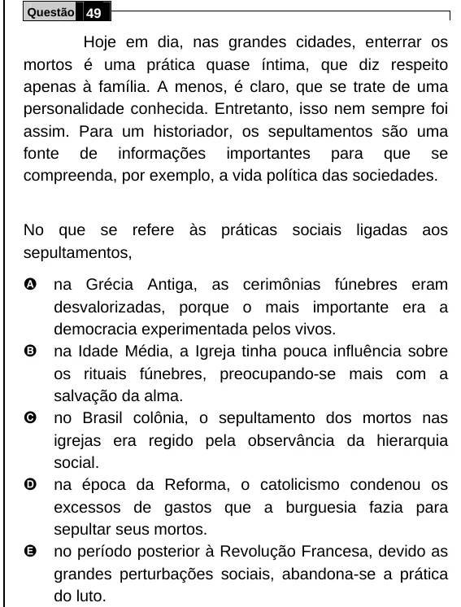

Texto extraído (pode conter ruído)

Questão 49  
Hoje em dia, nas grandes cidades, enterrar os  
mortos é uma prática quase íntima, que diz respeito  
apenas à família. A menos, é claro, que se trate de uma  
personalidade conhecida. Entretanto, isso nem sempre foi  
assim. Para um historiador, os sepultamentos são uma  
fonte de informações importantes para que se  
compreenda, por exemplo, a vida política das sociedades.  
No que se refere às práticas sociais ligadas aos  
sepultamentos,  
A  
na Grécia Antiga, as cerimônias fúnebres eram  
desvalorizadas, porque o mais importante era a  
democracia experimentada pelos vivos.  
B  
na Idade Média, a Igreja tinha pouca influência sobre  
os rituais fúnebres, preocupando-se mais com a  
salvação da alma.  
C  
no Brasil colônia, o sepultamento dos mortos nas  
igrejas era regido pela observância da hierarquia  
social.  
D  
na época da Reforma, o catolicismo condenou os  
excessos de gastos que a burguesia fazia para  
sepultar seus mortos.  
E  
no período posterior à Revolução Francesa, devido as  
grandes perturbações sociais, abandona-se a prática  
do luto.

