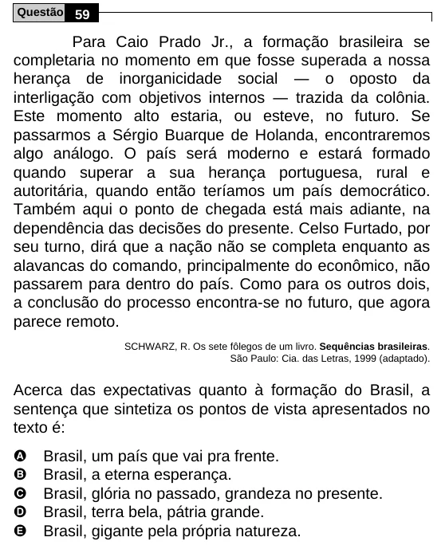

Texto extraído (pode conter ruído)

Questão 59  
Para Caio Prado Jr., a formação brasileira se  
completaria no momento em que fosse superada a nossa  
herança de inorganicidade social ― o oposto da  
interligação com objetivos internos ― trazida da colônia.  
Este momento alto estaria, ou esteve, no futuro. Se  
passarmos a Sérgio Buarque de Holanda, encontraremos  
algo análogo. O país será moderno e estará formado  
quando superar a sua herança portuguesa, rural e  
autoritária, quando então teríamos um país democrático.  
Também aqui o ponto de chegada está mais adiante, na  
dependência das decisões do presente. Celso Furtado, por  
seu turno, dirá que a nação não se completa enquanto as  
alavancas do comando, principalmente do econômico, não  
passarem para dentro do país. Como para os outros dois,  
a conclusão do processo encontra-se no futuro, que agora  
parece remoto.  
SCHWARZ, R. Os sete fôlegos de um livro. Sequências brasileiras.  
São Paulo: Cia. das Letras, 1999 (adaptado).  
Acerca das expectativas quanto à formação do Brasil, a  
sentença que sintetiza os pontos de vista apresentados no  
texto é:  
A  
Brasil, um país que vai pra frente.  
B  
Brasil, a eterna esperança.  
C  
Brasil, glória no passado, grandeza no presente.  
D  
Brasil, terra bela, pátria grande.  
E  
Brasil, gigante pela própria natureza.

