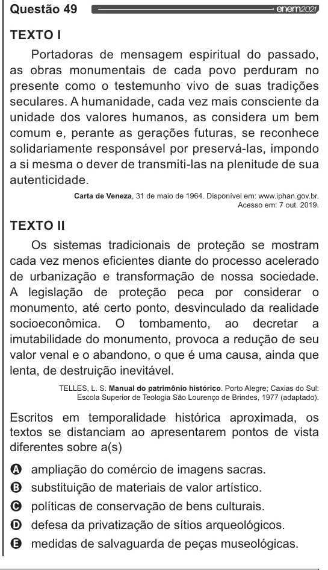

Texto extraído (pode conter ruído)

Questão 49  
TEXTO I  
Portadoras de mensagem espiritual do passado,  
as obras monumentais de cada povo perduram no  
presente como o testemunho vivo de suas tradições  
seculares. A humanidade, cada vez mais consciente da  
unidade dos valores humanos, as considera um bem  
comum e, perante as gerações futuras, se reconhece  
solidariamente responsável por preservá-las, impondo  
a si mesma o dever de transmiti-las na plenitude de sua  
autenticidade.  
Carta de Veneza, 31 de maio de 1964. Disponível em: www.iphan.gov.br.  
Acesso em: 7 out. 2019.  
TEXTO II  
Os sistemas tradicionais de proteção se mostram  
cada vez menos eficientes diante do processo acelerado  
de urbanização e transformação de nossa sociedade.  
A legislação de proteção peca por considerar o  
monumento, até certo ponto, desvinculado da realidade  
socioeconômica. O tombamento, ao decretar a  
imutabilidade do monumento, provoca a redução de seu  
valor venal e o abandono, o que é uma causa, ainda que  
lenta, de destruição inevitável.  
TELLES, L. S. Manual do patrimônio histórico. Porto Alegre; Caxias do Sul:  
Escola Superior de Teologia São Lourenço de Brindes, 1977 (adaptado).  
Escritos em temporalidade histórica aproximada, os  
textos se distanciam ao apresentarem pontos de vista  
diferentes sobre a(s)  
Q ampliação do comércio de imagens sacras.  
O substituição de materiais de valor artístico.  
O políticas de conservação de bens culturais.  
O defesa da privatização de sítios arqueológicos.  
& medidas de salvaguarda de peças museológicas.

