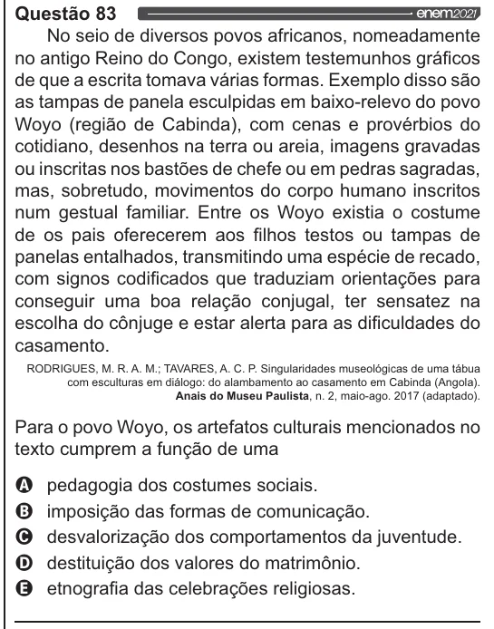

Texto extraído (pode conter ruído)

Questão 83  
No seio de diversos povos africanos, nomeadamente  
no antigo Reino do Congo, existem testemunhos gráficos  
de que a escrita tomava várias formas. Exemplo disso são  
as tampas de panela esculpidas em baixo-relevo do povo  
Woyo (região de Cabinda), com cenas e provérbios do  
cotidiano, desenhos na terra ou areia, imagens gravadas  
ou inscritas nos bastões de chefe ou em pedras sagradas,  
mas, sobretudo, movimentos do corpo humano inscritos  
num gestual familiar. Entre os Woyo existia o costume  
de os pais oferecerem aos filhos testos ou tampas de  
panelas entalhados, transmitindo uma espécie de recado,  
com signos codificados que traduziam orientações para  
conseguir uma boa relação conjugal, ter sensatez na  
escolha do cônjuge e estar alerta para as dificuldades do  
casamento.  
RODRIGUES, M. R. A. M.; TAVARES, A. C. P. Singularidades museológicas de uma tábua  
com esculturas em diálogo: do alambamento ao casamento em Cabinda (Angola).  
Anais do Museu Paulista, n. 2, maio-ago. 2017 (adaptado).  
Para o povo Woyo, os artefatos culturais mencionados no  
texto cumprem a função de uma  
VOVOO  
pedagogia dos costumes sociais.  
imposição das formas de comunicação.  
desvalorização dos comportamentos da juventude.  
destituição dos valores do matrimônio.  
etnografia das celebrações religiosas.

