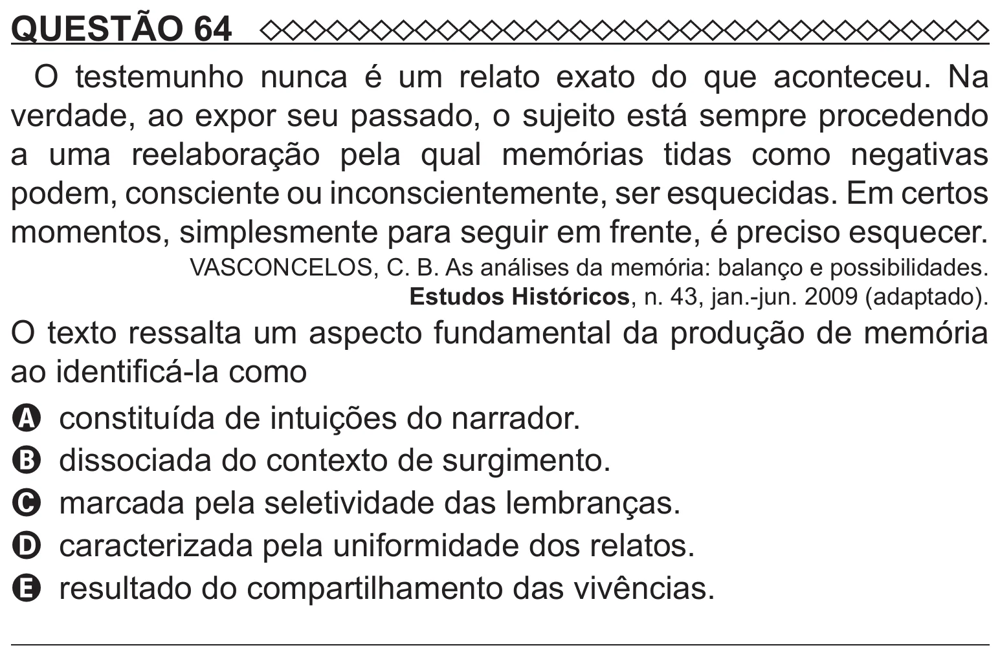

Texto extraído (pode conter ruído)

QUESTÃO 64  
O testemunho nunca é um relato exato do que aconteceu. Na  
verdade, ao expor seu passado, o sujeito está sempre procedendo  
a uma reelaboração pela qual memórias tidas como negativas  
podem, consciente ou inconscientemente, ser esquecidas. Em certos  
momentos, simplesmente para seguir em frente, é preciso esquecer.  
VASCONCELOS, C. B. As análises da memória: balanço e possibilidades.  
Estudos Históricos, n. 43, jan.-jun. 2009 (adaptado).  
O texto ressalta um aspecto fundamental da produção de memória  
ao identificá-la como  
A constituída de intuições do narrador.  
B dissociada do contexto de surgimento.  
C marcada pela seletividade das lembranças.  
D caracterizada pela uniformidade dos relatos.  
E resultado do compartilhamento das vivências.

