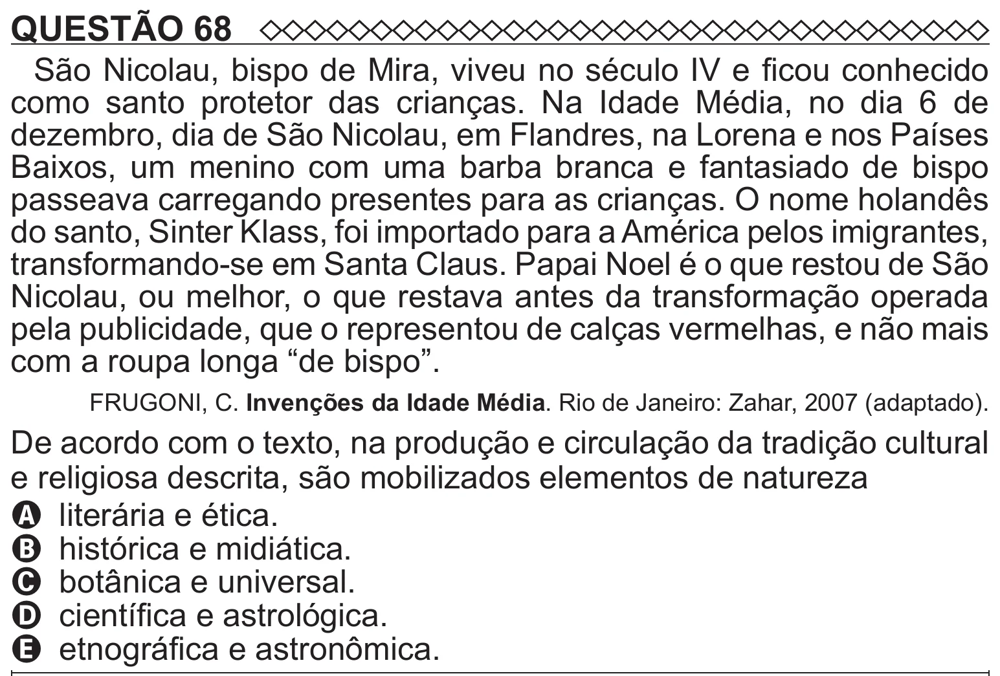

Texto extraído (pode conter ruído)

QUESTÃO 68  
São Nicolau, bispo de Mira, viveu no século IV e ficou conhecido  
como santo protetor das crianças. Na Idade Média, no dia 6 de  
dezembro, dia de São Nicolau, em Flandres, na Lorena e nos Países  
Baixos, um menino com uma barba branca e fantasiado de bispo  
passeava carregando presentes para as crianças. O nome holandês  
do santo, Sinter Klass, foi importado para a América pelos imigrantes,  
transformando-se em Santa Claus. Papai Noel é o que restou de São  
Nicolau, ou melhor, o que restava antes da transformação operada  
pela publicidade, que o representou de calças vermelhas, e não mais  
com a roupa longa “de bispo”.  
FRUGONI, C. Invenções da Idade Média. Rio de Janeiro: Zahar, 2007 (adaptado).  
De acordo com o texto, na produção e circulação da tradição cultural  
e religiosa descrita, são mobilizados elementos de natureza  
A literária e ética.  
B histórica e midiática.  
C botânica e universal.  
D científica e astrológica.  
E etnográfica e astronômica.

