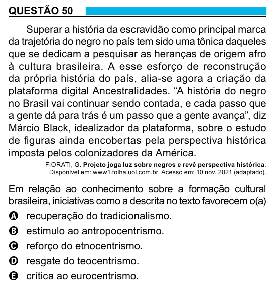

Texto extraído (pode conter ruído)

QUESTÃO 50  
Superar a história da escravidão como principal marca  
da trajetória do negro no país tem sido uma tônica daqueles  
que se dedicam a pesquisar as heranças de origem afro  
à cultura brasileira. A esse esforço de reconstrução  
da própria história do país, alia-se agora a criação da  
plataforma digital Ancestralidades. “A história do negro  
no Brasil vai continuar sendo contada, e cada passo que  
a gente dá para trás é um passo que a gente avança”, diz  
Márcio Black, idealizador da plataforma, sobre o estudo  
de figuras ainda encobertas pela perspectiva histórica  
imposta pelos colonizadores da América.  
FIORATI, G. Projeto joga luz sobre negros e revê perspectiva histórica.  
Disponível em: www1.folha.uol.com.br. Acesso em: 10 nov. 2021 (adaptado).  
Em relação ao conhecimento sobre a formação cultural  
brasileira, iniciativas como a descrita no texto favorecem o(a)  
A recuperação do tradicionalismo.  
B estímulo ao antropocentrismo.  
C reforço do etnocentrismo.  
D resgate do teocentrismo.  
E crítica ao eurocentrismo.

