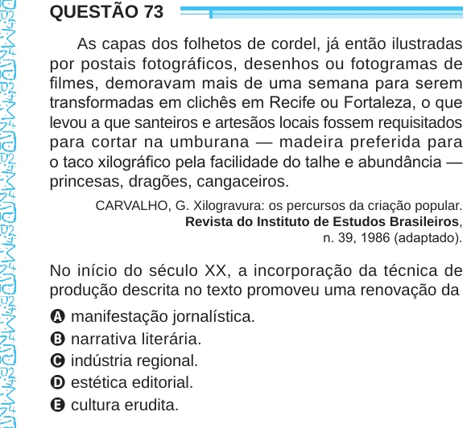

Texto extraído (pode conter ruído)

QUESTÃO 73  
As capas dos folhetos de cordel, já então ilustradas  
por postais fotográficos, desenhos ou fotogramas de  
filmes, demoravam mais de uma semana para serem  
transformadas em clichês em Recife ou Fortaleza, o que  
levou a que santeiros e artesãos locais fossem requisitados  
para cortar na umburana — madeira preferida para  
o taco xilográfico pela facilidade do talhe e abundância —  
princesas, dragões, cangaceiros.  
CARVALHO, G. Xilogravura: os percursos da criação popular.  
Revista do Instituto de Estudos Brasileiros,  
n. 39, 1986 (adaptado).  
No início do século XX, a incorporação da técnica de  
produção descrita no texto promoveu uma renovação da  
A manifestação jornalística.  
B narrativa literária.  
C indústria regional.  
D estética editorial.  
E cultura erudita.

