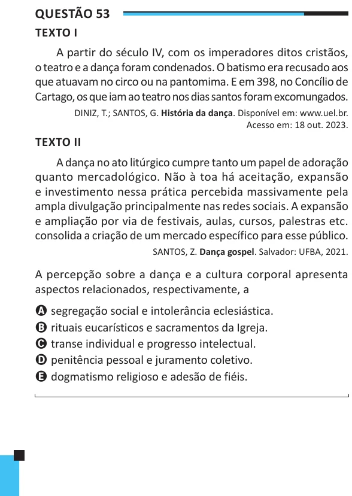

Texto extraído (pode conter ruído)

Questão 53  
TEXTO I  
A partir do século IV, com os imperadores ditos cristãos,  
o teatro e a dança foram condenados. O batismo era recusado aos  
que atuavam no circo ou na pantomima. E em 398, no Concílio de  
Cartago, os que iam ao teatro nos dias santos foram excomungados.  
DINIZ, T.; SANTOS, G. História da dança. Disponível em: www.uel.br.  
Acesso em: 18 out. 2023.  
TEXTO II  
A dança no ato litúrgico cumpre tanto um papel de adoração  
quanto mercadológico. Não à toa há aceitação, expansão  
e investimento nessa prática percebida massivamente pela  
ampla divulgação principalmente nas redes sociais. A expansão  
e ampliação por via de festivais, aulas, cursos, palestras etc.  
consolida a criação de um mercado específico para esse público.  
SANTOS, Z. Dança gospel. Salvador: UFBA, 2021.  
A percepção sobre a dança e a cultura corporal apresenta  
aspectos relacionados, respectivamente, a  
A segregação social e intolerância eclesiástica.  
B rituais eucarísticos e sacramentos da Igreja.  
C transe individual e progresso intelectual.  
D penitência pessoal e juramento coletivo.  
E dogmatismo religioso e adesão de fiéis.

