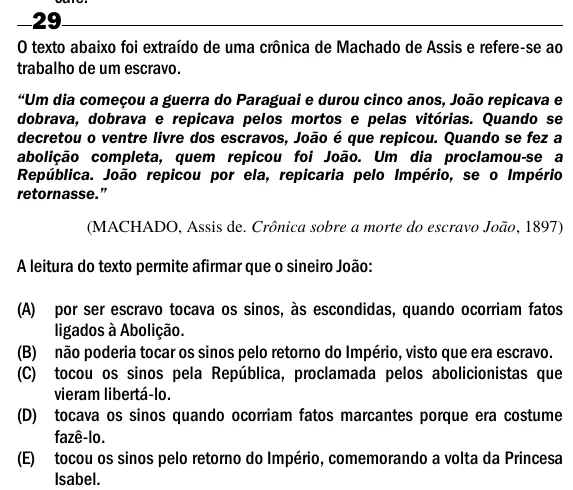

Texto extraído (pode conter ruído)

29  
O texto abaixo foi extraído de uma crônica de Machado de Assis e refere-se ao  
trabalho de um escravo.  
―Um dia começou a guerra do Paraguai e durou cinco anos, João repicava e  
dobrava, dobrava e repicava pelos mortos e pelas vitórias. Quando se  
decretou o ventre livre dos escravos, João é que repicou. Quando se fez a  
abolição completa, quem repicou foi João. Um dia proclamou-se a  
República. João repicou por ela, repicaria pelo Império, se o Império  
retornasse.‖  
(MACHADO, Assis de. Crônica sobre a morte do escravo João, 1897)  
A leitura do texto permite afirmar que o sineiro João:  
(A) por ser escravo tocava os sinos, às escondidas, quando ocorriam fatos  
ligados à Abolição.  
(B) não poderia tocar os sinos pelo retorno do Império, visto que era escravo.  
(C) tocou os sinos pela República, proclamada pelos abolicionistas que  
vieram libertá-lo.  
(D) tocava os sinos quando ocorriam fatos marcantes porque era costume  
fazê-lo.  
(E) tocou os sinos pelo retorno do Império, comemorando a volta da Princesa  
Isabel.

