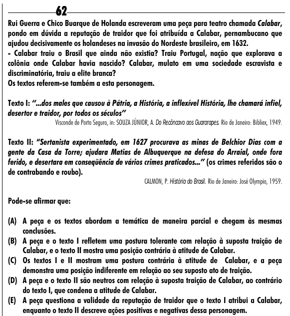

Texto extraído (pode conter ruído)

62  
Rui Guerra e Chico Buarque de Holanda escreveram uma peça para teatro chamada Calabar,  
pondo em dúvida a reputação de traidor que foi atribuída a Calabar, pernambucano que  
ajudou decisivamente os holandeses na invasão do Nordeste brasileiro, em 1632.  
- Calabar traiu o Brasil que ainda não existia? Traiu Portugal, nação que explorava a  
colônia onde Calabar havia nascido? Calabar, mulato em uma sociedade escravista e  
discriminatória, traiu a elite branca?  
Os textos referem-se também a esta personagem.  
Texto I: “...dos males que causou à Pátria, a História, a inflexível História, lhe chamará infiel,  
desertor e traidor, por todos os séculos”  
Visconde de Porto Seguro, in: SOUZA JÚNIOR, A. Do Recôncavo aos Guararapes. Rio de Janeiro: Bibliex, 1949.  
Texto II: “Sertanista experimentado, em 1627 procurava as minas de Belchior Dias com a  
gente da Casa da Torre; ajudara Matias de Albuquerque na defesa do Arraial, onde fora  
ferido, e desertara em conseqüência de vários crimes praticados...” (os crimes referidos são o  
de contrabando e roubo).  
CALMON, P. História do Brasil. Rio de Janeiro: José Olympio, 1959.  
Pode-se afirmar que:  
(A) A peça e os textos abordam a temática de maneira parcial e chegam às mesmas  
conclusões.  
(B) A peça e o texto I refletem uma postura tolerante com relação à suposta traição de  
Calabar, e o texto II mostra uma posição contrária à atitude de Calabar.  
(C) Os textos I e II mostram uma postura contrária à atitude de Calabar, e a peça  
demonstra uma posição indiferente em relação ao seu suposto ato de traição.  
(D) A peça e o texto II são neutros com relação à suposta traição de Calabar, ao contrário  
do texto I, que condena a atitude de Calabar.  
(E) A peça questiona a validade da reputação de traidor que o texto I atribui a Calabar,  
enquanto o texto II descreve ações positivas e negativas dessa personagem.

