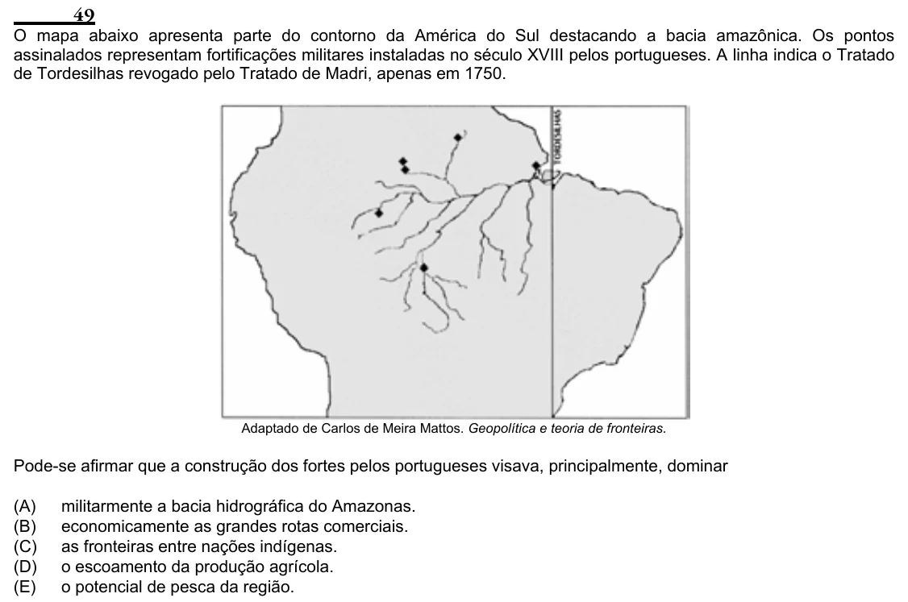

Texto extraído (pode conter ruído)

49  
O mapa abaixo apresenta parte do contorno da América do Sul destacando a bacia amazônica. Os pontos  
assinalados representam fortificações militares instaladas no século XVIII pelos portugueses. A linha indica o Tratado  
de Tordesilhas revogado pelo Tratado de Madri, apenas em 1750.  
Adaptado de Carlos de Meira Mattos. Geopolítica e teoria de fronteiras.  
Pode-se afirmar que a construção dos fortes pelos portugueses visava, principalmente, dominar  
(A)  
militarmente a bacia hidrográfica do Amazonas.  
(B)  
economicamente as grandes rotas comerciais.  
(C)  
as fronteiras entre nações indígenas.  
(D)  
o escoamento da produção agrícola.  
(E)  
o potencial de pesca da região.

