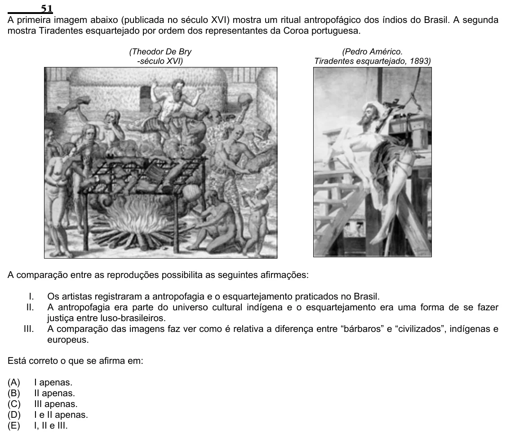

Texto extraído (pode conter ruído)

51  
A primeira imagem abaixo (publicada no século XVI) mostra um ritual antropofágico dos índios do Brasil. A segunda  
mostra Tiradentes esquartejado por ordem dos representantes da Coroa portuguesa.  
(Theodor De Bry  
(Pedro Américo.  
-século XVI)  
Tiradentes esquartejado, 1893)  
A comparação entre as reproduções possibilita as seguintes afirmações:  
I.  
Os artistas registraram a antropofagia e o esquartejamento praticados no Brasil.  
II.  
A antropofagia era parte do universo cultural indígena e o esquartejamento era uma forma de se fazer  
justiça entre luso-brasileiros.  
III.  
A comparação das imagens faz ver como é relativa a diferença entre “bárbaros” e “civilizados”, indígenas e  
europeus.  
Está correto o que se afirma em:  
(A)  
I apenas.  
(B)  
II apenas.  
(C)  
III apenas.  
(D)  
I e II apenas.  
(E)  
I, II e III.

